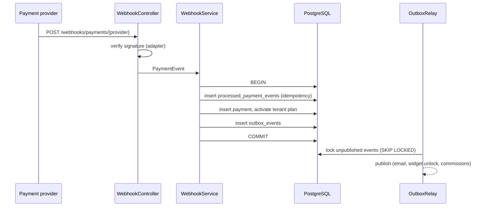

# Billing service – Spring Boot showcase

Extract of the account & billing service of **Telemaco**, a multi-tenant conversational AI platform
(voice and text assistants that book appointments, rooms and vehicles for small businesses).

This repository is a **code sample for portfolio review**: it shows the patterns used in the real
service, with simplified domain code. Provider adapters, pricing and business rules are not included.

## What it shows

| Pattern | Where |
|---|---|
| **Payment provider behind a port** – switching provider touches only an adapter | `payment/PaymentProvider.java` |
| **Webhook processing in one transaction** – idempotency record, payment, plan activation and outbox event commit together | `payment/PaymentWebhookService.java` |
| **Idempotent webhooks** – provider retries are safe | `processed_payment_events` table |
| **Transactional outbox + relay** – at-least-once delivery, `FOR UPDATE SKIP LOCKED` for multiple replicas | `outbox/` |
| **Tenant isolation at ORM level** with Hibernate 6 `@TenantId` | `tenant/Payment.java`, `TenantIdentifierResolver.java` |
| **Plan read from the database, never from the browser or the JWT** | `tenant/Tenant.java` |
| Flyway migrations, unit tests with Mockito | `db/migration`, `src/test` |

## Flow



## Run the tests

```bash
mvn test
```

Stack: Java 21, Spring Boot 3, Spring Data JPA / Hibernate 6, PostgreSQL, Flyway, JUnit 5, Mockito.
